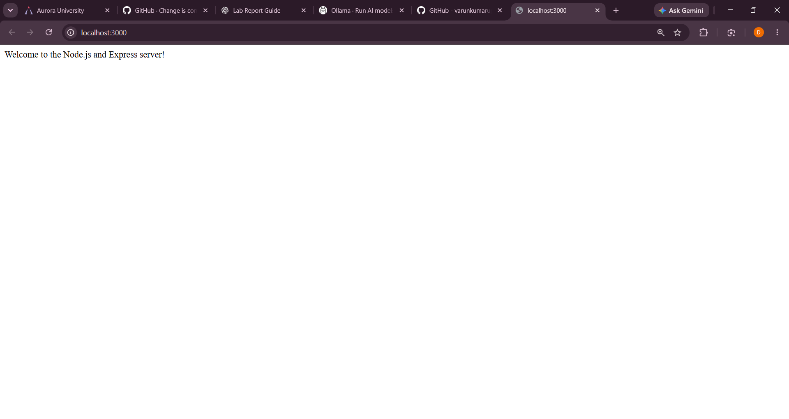
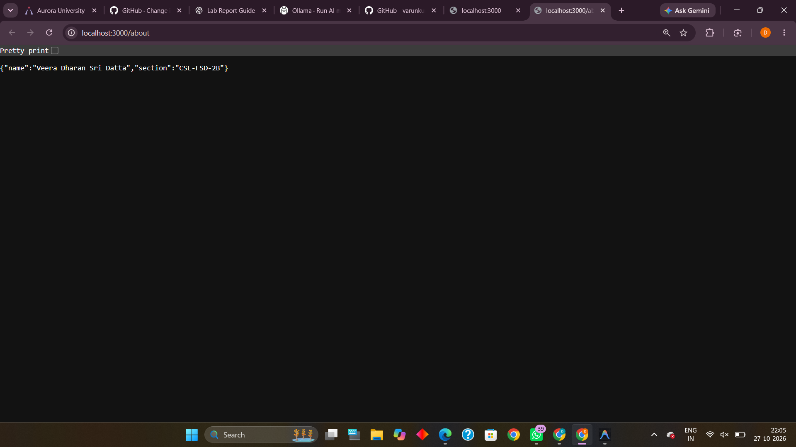
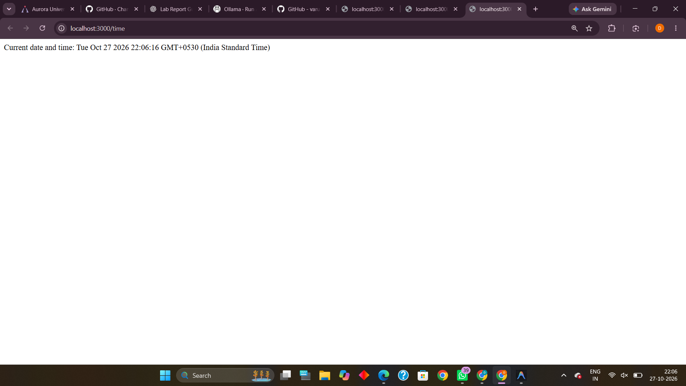
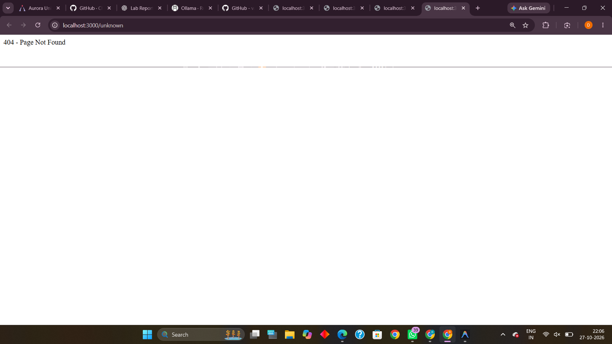

# Lab 1: Node.js and Express server

**Name:** Veera Dharan Sri Datta · **Registration number:** 252U1R7096 · **Section:** CSE-FSD-2B

**Live link:** https://backend-development-fundamentals-l1.onrender.com

## How to run

```bash
npm install          # installs express (node_modules is not committed)
npm start            # Express server  -> http://localhost:3000
npm run plain        # plain http module server (Task 3) -> http://localhost:3000
```

Environment variables: optional `PORT` (defaults to 3000). No secrets are needed.

## Endpoints

| Method | Path | Status | Description |
|--------|------|--------|-------------|
| GET | `/` | 200 | Welcome text |
| GET | `/about` | 200 | JSON with name and section |
| GET | `/time` | 200 | Current date and time (`new Date()`) |
| any | anything else | 404 | "404 - Page Not Found" |

## Files

- `http-server.js` – Task 3, server with built-in `http.createServer` replying "Hello"
- `server.js` – Tasks 4–6, Express server with routes and 404 handler
- `package.json` – project metadata and scripts

## Status codes observed (Task 7)

| Route | Status |
|-------|--------|
| `/` | 200 |
| `/about` | 200 |
| `/time` | 200 |
| `/unknown` | 404 |

## Screenshots






## package.json fields (Task 1)

- `name` – project name; `version` – semantic version; `description` – short summary
- `main` – entry file; `scripts` – commands run with `npm run` (`npm start`)
- `author`, `license` – owner and licence; `dependencies` – packages the app needs at runtime (express)

## Viva notes

- **package.json vs node_modules:** package.json is the manifest listing metadata and dependencies; node_modules is the folder where the installed packages are downloaded (generated, not committed).
- **app.listen:** binds the app to a port and starts accepting HTTP connections; the callback runs once it is listening.
- **request / response:** `req` is the incoming HTTP request (method, URL, headers, params); `res` is the object used to build and send the reply (status, headers, body).

## Notes: problems faced and how I solved them

- The 404 handler must be registered after all other routes, otherwise it would catch valid paths.
